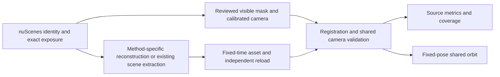

# Human Asset Comparison

**A traceable experimental framework for reconstructing and evaluating human assets from nuScenes.**

[中文说明](README_zh-CN.md) · [Reproduction](docs/REPRODUCING.md) · [Evaluation protocol](docs/EVALUATION.md) · [Methods and dependencies](docs/METHODS.md) · [Release status](docs/STATUS.md) · [Incremental batch workflow (中文)](docs/METRIC_BATCH_WORKFLOW_zh-CN.md)

> **Research preview — November 2026.** Six methods have 526 valid source-view results on a frozen 100-person cohort, with coverage-aware paired tables. ED-P, common orbits, three dynamic pilots and one fixed-cache backend ablation are available. Full dynamic/ablation batches and input-budget disclosure remain incomplete. This is an integration source release, not a self-contained end-to-end training distribution.

## Overview

We study human assets at the **same identity, real exposure time, and observed pose**, with two complementary outputs:

1. **Source-view reconstruction:** compare rendered assets with the real input using a common calibrated camera, white background, and reference-defined region of interest.
2. **Fixed-pose orbit inspection:** expose side/back missing surfaces, blur, floaters, and appearance errors using shared camera settings. Without real backside observations, these views do not receive image-reference scores.

The frozen cohort contains **100 nuScenes identities**: 75 retained cases and 25 additions selected through real-reference review. Method failures never trigger replacement of an identity. The comparison covers Ours (4DAnyone Turbo + Grid4D), Asset Harvester, original TRELLIS, TRELLIS.2, OmniRe, and SplatAD. Additional integrations are currently deferred.



## Design principles

- **Preserve identity and time.** Use the frozen raw exposure; do not substitute a neighboring frame or a more favorable pose.
- **Share the viewing conditions.** Register assets in 3D, render with the same camera, and apply one reference-defined ROI. Do not independently center/scale predicted silhouettes.
- **Keep native errors visible.** Preserve predicted pose, full Gaussian covariance, spherical harmonics, and required native decoders. The reference mask is never used to erase prediction errors.
- **Report missingness.** Technical failures are NA with reasons; a valid empty prediction is scored. Main comparisons use the same valid people across methods and report `n/100`.
- **Separate reconstruction from generalization.** Source images may have been used in generation, fitting, or training. Source-view scores are not automatically held-out scores.

## Quick start: core metrics

The core metric package runs without downloading model checkpoints or loading nuScenes:

```bash
git clone https://github.com/jincenou/human_model_comparison.git
cd human_model_comparison
python -m venv .venv
source .venv/bin/activate
python -m pip install -e '.[test]'
python -m pytest -q

# Synthetic contract check: demonstrates I/O and arithmetic, not benchmark performance.
python tools/make_synthetic_example.py artifacts/example
hmc-score artifacts/example/pair.json --output artifacts/example/scores.json
```

For LPIPS, install `.[metrics]` and supply both local AlexNet and LPIPS linear-weight files with their expected SHA256 hashes in the pair manifest. No checkpoint is downloaded implicitly by the scorer. See [evaluation instructions](docs/EVALUATION.md).

## Experiment code

```text
src/human_asset_benchmark/       Portable metric implementation, pair scorer, path resolver
tests/                           Numerical and provenance-contract checks
tools/                           Synthetic example and release validation
metadata/cohort.json             Frozen identity/time cohort; no dataset pixels
metadata/templates/              Path-parameterized experiment metadata
metadata/source_provenance.json  Original and published source hashes
environments/                    Observed core package versions
workspace/human_model_comparison/
  scripts/                       Reference, extraction, reload, rendering and metric adapters
  model_preparation/.../scripts/  Method-specific environment/weight preparation history
workspace/human/                 First-party producer and playback orchestration
workspace/Hasim_trajectory_assets/src/
                                 Minimal first-party Gaussian runtime modules
workspace/vehicle_model_comparison/
                                 Shared camera/resource helpers used by human adapters
```

The `workspace/` layout preserves relative imports between the experimental adapters. The included producer orchestration supports historical routes beyond this benchmark; the released benchmark cohort and protocol use **nuScenes only**. Upstream model implementations, licensed body models, generated images, checkpoints, and private run directories are not bundled.

Configure installation paths using [`.env.example`](.env.example), then follow [REPRODUCING.md](docs/REPRODUCING.md). The workspace scripts are a research integration snapshot: they require method repositories, input preparation, and runtime manifests described there. Running all scripts in filename order is not a supported workflow.

## Evaluation

| Metric | Definition in this release |
| --- | --- |
| PSNR | Float64 MSE over the entire shared ROI in sRGB `[0,1]`; exact equality is positive infinity |
| SSIM | Gaussian 11×11 window, σ=1.5, population covariance, K1=0.01, K2=0.03, RGB mean |
| LPIPS | AlexNet v0.1, fixed local weight hashes, eval/float32, RGB normalized to `[-1,1]` |
| IoU | Byte mask threshold `>127`; shared ROI and raw full-canvas variants |
| ED-P_common | Frozen six-part DINOv3 ViT-L/16 and DWPose variant; common identities and common parts, with coverage |
| tOF / tLP100 | Matched actual-exposure optical-flow and adjacent perceptual-change differences; three-person pilot |

The reference mask includes clothes, worn backpacks, and carried items. The ROI is a square centered on the reference mask bounding box with side length `ceil(1.10 × longest side)`, padded white outside the canvas, then resized to 512×512. RGB uses bicubic interpolation; masks use nearest neighbor. See the [full protocol and limitations](docs/EVALUATION.md).

## Current release scope

| Component | Available evidence | Remaining work |
|---|---|---|
| Cohort/reference | v3 fixed100, all100 eligible under reference policy v5 | Preserve identity and missingness |
| Source metrics | 526 pairs; five-method common77, six-method common46 | Input-budget disclosure |
| ED-P auxiliary | 509 valid pairs; common-part comparisons | Additional visibility review |
| Common orbits | 526×16 views, full100 local gallery | Broader visual inspection |
| Dynamic comparison | Three common identities, 86 actual frame pairs | Expand audited clips |
| Backend ablation | One identity, three variants including matched budget | Expand fixed-cache cohort |

See [recorded results](results/20261112/README.md) and [current workflow](docs/CURRENT_WORKFLOW.md).

No final leaderboard, paper acceptance, or state-of-the-art claim is made by this release. The detailed [status](docs/STATUS.md) distinguishes observed results from planned work.

## Data, weights, and licensing

Obtain nuScenes and method weights through their respective providers. A community mirror's repository license does not supersede the original SMPL/SMPL-X/FLAME or checkpoint terms. No model credentials, personal server paths, dataset photos, or weights are intentionally distributed here.

See [THIRD_PARTY.md](THIRD_PARTY.md) for provenance and ownership boundaries. This preview does **not** choose a blanket open-source license on behalf of all contributors. A project-wide license and paper citation will be added when confirmed; no BibTeX entry is fabricated.

## Reproducibility and contributions

Please include the repository commit, environment versions, input/camera/weight hashes, and affected identity when reporting a problem. Do not attach restricted dataset images or credentials to public issues. Changes to camera geometry, alpha handling, or missing-data aggregation should include a focused numerical test. See [CONTRIBUTING.md](CONTRIBUTING.md). An optional [GitHub Actions template](docs/ci/README.md) is included; hosted CI is not enabled by this release.

